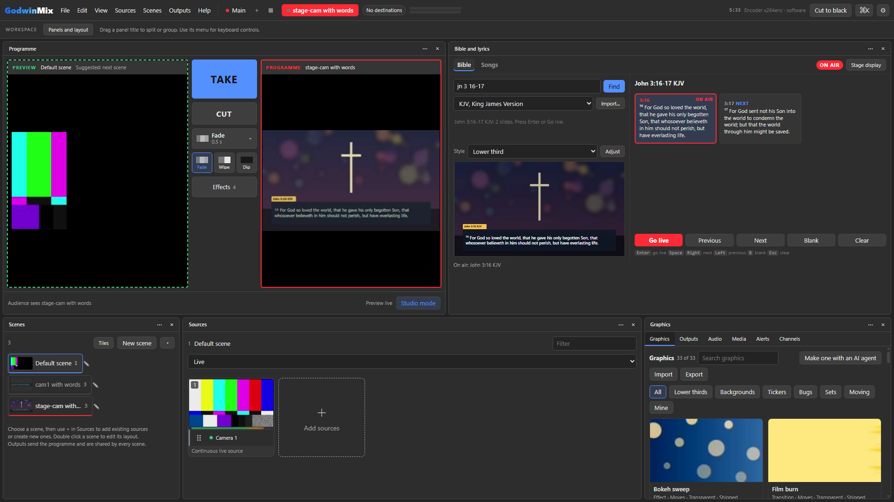

# Bible Verses and Lyrics for GodwinMix

A plugin for the [GodwinMix](https://github.com/psmux/GodwinMix) live video
mixer that puts Bible verses and song words on the programme. It was written
for churches that stream their services with one volunteer at the desk.



What it does:

* Type a reference the way you would say it (`John 3:16`, `jn 3 16`,
  `1 Cor 13:4-7`, `Ps 23`, `Gen 1:1-2:3`) or a few words you remember, and it
  finds the passage. A slip of the finger still works: `Jhon 3:16` is John.
* The King James Version and the World English Bible come with it. Both are
  public domain. A translation your church is licensed to show can be
  imported from USFM, OSIS XML, Zefania XML or a simple table.
* A song library with verses, choruses and bridges and the order you sing
  them in (`V1 C V2 C B C`). Import plain text, OpenLyrics or ChordPro.
* Long passages and long verses are cut into slides that fit the style you
  picked, at the end of a verse or a sentence where it can.
* Five looks: a lower third over the camera, full screen verses, a centred
  verse with no box, lyrics at the bottom, and full screen lyrics. Font, size,
  colours, box, shadow, alignment and margins can all be changed. They fit
  720p and 1080p.
* Step with the keyboard, blank the screen without losing your place, clear.
* A stage display page for the band or the preacher: the slide on air in big
  letters and the next one under it.

## Install

You need GodwinMix 0.3.9 or newer, and Python 3.10 or newer on the machine the
mixer runs on (`python3 --version`; on Windows, `python --version`). The
plugin uses nothing outside Python's standard library, so nothing else is
downloaded.

From the mixer's Plugins page, find **Bible Verses and Lyrics** and press
**Install**. Or from a terminal:

```sh
gmx plugin add psmux/godwinmix-scripture
```

That fetches the release for your computer. To install from a copy of this
repository instead:

```sh
git clone https://github.com/psmux/godwinmix-scripture
gmx plugin add ./godwinmix-scripture
```

Reload the mixer's page. **Bible and lyrics** appears as a tab beside
Graphics, Outputs and the others on the right. It has more room beside the
programme: press the panel's actions button (the dots on its title bar), set
**Destination panel** to Programme and **Position** to Split right, and press
**Move panel**. The screenshots are taken that way.

On GodwinMix 0.3.9 the page looks for a plugin's panel one folder above where
`gmx plugin add` installs it. The plugin copies its panel there when it
starts, inside its own folder in the plugins directory, so you do not have to
do anything. When the mixer reads the panel from the installed folder this
copy is simply not needed.

## Use it

### Verses

1. Pick the **Bible** tab and type a reference or some words in the box.
   Press Enter.
2. A reference shows its slides on the right. Words show a list of verses
   that hold all of them; click one to open it.
3. Press **Go live** (or Enter). The first slide goes on the programme over
   whatever is there.
4. Press the Right arrow or Space for the next slide, Left for the one before.

The reference and the translation show with the words, for example
`John 3:16 KJV`. A passage of several verses gets small verse numbers; turn
them off in the plugin's settings if you prefer.

You can name a translation in the box: `John 3:16 WEB`.

### Songs

1. Pick the **Songs** tab. Type to find a song by its title, its words, its
   author or its CCLI number.
2. Click a song. Its slides appear in the order set for it. Change the order
   in the **Order** box (`V1 C V2 C B C`) and press **Apply**.
3. Press **Go live**, then step through with the keys. Click a slide to jump
   to it while the song is on air, or click a section button (V1, C, B) to go
   to the next time that section is sung.

**New** opens an editor. Write the song like this:

```
Title: Amazing Grace
Author: John Newton
Order: V1 V2 V3

[Verse 1]
Amazing grace! How sweet the sound
That saved a wretch like me!
```

A `CCLI:` line holds the song's CCLI number, and `Copyright:` its copyright line.
Headings can be `[Verse 1]`, `Verse 1`, `V1`, `[Chorus]`, `[Bridge]`,
`[Pre chorus]`, `[Tag]`, `[Intro]` or `[Ending]`. A chorus written out again
later is recognised as the same chorus sung again. A section too long for one
slide is split by itself at the end of a line.

**Import** takes plain text in that form, OpenLyrics XML (the format OpenLP
and others export) and ChordPro (`.cho`, `.chordpro`, `.pro`). Chords are
removed: the congregation sees the words.

### The keys

The panel answers keys while it has focus (click on it once).

| Key | What it does |
|---|---|
| Enter | go live with the selected slide |
| Right, Down, Space, Page Down | next slide |
| Left, Up, Page Up | previous slide |
| B | blank the words, and press again to bring them back |
| Escape | clear: take the words off the programme |

With nothing on air, the arrows move the selection so you can pick a slide
before you go live.

### Styles

The **Style** list under the search box changes the look for verses or for
songs, whichever you are looking at. The preview under it shows the selected
slide in that style over what is on the programme now. **Adjust** opens the
fine settings: size, alignment, the colour of the words and of the reference,
the box behind the words, the shadow, the margin and the font. A font has to
be installed on the mixer's computer; a name it does not have falls back to
the ordinary sans serif.

Changing the style while words are on air changes them on air too, cut for
the new box.

### Where the words go

The words are two text items in the scene on the programme, drawn by the
mixer's own text source with no browser. A new slide changes the words of
those items in place, so there is no gap and no flash. If you take another
scene while words are up, they follow you onto it.

If the programme is a single camera rather than a scene, **Go live** makes a
scene called "<camera> with words" holding that camera full frame, and takes
it. The picture does not change apart from the words.

### Stage display

Press **Stage display** in the panel. The plugin starts a small web page on
the mixer's computer, by default at `http://<mixer>:8091/`, and opens it. Open
the same address on a tablet or a screen for the band or the preacher. It
shows the slide on air in large letters, the next slide under it, the section
or verse, and the time. It follows the operator as soon as a slide changes.

Nothing listens until someone presses the button. The address and port are in
the plugin's settings (`stage_bind`, `stage_port`); set `stage_bind` to
`127.0.0.1` to keep it on the mixer's own computer.

## Importing a translation you are licensed to show

Modern translations such as the NIV, ESV, NLT and NKJV are under copyright,
so they do not come with this plugin. If your church has permission from the
publisher (many give it for projection in worship, within limits, and some
licences cover streaming), import the text you were given:

1. In the **Bible** tab press **Import...**.
2. Pick the file. These are read:
   * **USFM**, one file per book, or the zip that holds them all
     (Paratext, eBible.org and many Bible societies publish this).
   * **OSIS XML** (SWORD modules and Crosswire).
   * **Zefania XML**.
   * **A table**, one verse a line: `book,chapter,verse,text`, comma or tab
     separated. The book can be a name (`John`, `1 Corinthians`), an
     abbreviation (`Jn`), a USFM code (`JHN`) or a number from 1 to 66.
3. Give it the abbreviation to show on air (`NIV`), its name, and a line
   saying under what right you show it. That line is kept with the text.
4. Press **Import**. It takes a few seconds for a whole Bible.

The text is stored on the mixer's computer and never sent anywhere. It is
kept in the plugin's data folder, which survives updates of the plugin.

### API.Bible

If your church has a key from [API.Bible](https://scripture.api.bible), put it
in the plugin's settings as `api_bible_key`. The translations that key can
read are then available by an id starting `api:`, fetched when you look a
passage up and kept in memory only. The copyright line API.Bible sends is
shown with the words. API.Bible's terms ask for usage reports through its
Fair Use Management System, which this plugin does not send, so read those
terms before using it on air. This part has been tested against a stand in
server, not against API.Bible itself.

## Lyrics and licensing

Showing song words in a service, and streaming them, usually needs a licence
such as a CCLI Church Copyright Licence and a streaming licence. Getting one
and reporting the songs you use is the church's responsibility. The plugin
helps by keeping each song's CCLI number and showing a credit line (title,
author, copyright, CCLI song number and your licence number) on the first and
last slide of a song. Put your licence number in the settings as
`ccli_licence`; set `ccli_footer` to `every` or `none` to show it on every
slide or not at all.

## Settings

Set in the mixer's settings for the plugin, or under `[plugins.scripture]` in
the mixer's config file.

| Setting | Default | What it does |
|---|---|---|
| `default_translation` | `kjv` | the translation used when none is named |
| `verse_numbers` | `true` | small verse numbers when a slide holds more than one verse |
| `ccli_licence` | empty | your CCLI licence number, for the song credit |
| `ccli_footer` | `first` | the song credit on the first and last slides, on `every` slide, or `none` |
| `bible_style`, `song_style` | `lower-third`, `lyrics-lower` | the styles the plugin starts with |
| `api_bible_key` | empty | your own API.Bible key |
| `stage_bind`, `stage_port` | `0.0.0.0`, `8091` | where the stage display listens once started |
| `data_dir` | empty | where songs and imported translations are kept; empty means a `data` folder beside the installed plugin |

## For agents

The plugin's tools are open to AI agents through the mixer's MCP server, as
`gmx_scripture_<tool>`: `find`, `lookup`, `search`, `songs`, `song_deck`,
`song_save`, `state` and the rest. An agent can prepare a passage or a song
and read what is live. Putting words on the programme is done from the panel.

## The Bible texts

See [BIBLE-TEXTS.md](BIBLE-TEXTS.md) for where the bundled translations come
from, their checksums and their licences.

## Building and testing

```sh
python -m unittest discover -s tests -t .     # every unit test, no mixer needed
python tools/build_bibles.py                  # fetch and convert the bundled Bibles again
python tools/package.py                       # the release archives, into dist/
```

`dev/` holds the real check: `dev/e2e.mjs` drives a running mixer's own web
page in headless Chrome, puts verses and a hymn on air, steps, blanks and
clears, and records the programme; `dev/frames.py` checks the recorded
programme changed when it should and did not when it should not. The gallery
pictures come from `dev/gallery.mjs` and `dev/pictures.py`.

## Licence

The code is MIT, see [LICENSE](LICENSE). The bundled Bible texts are public
domain, see [BIBLE-TEXTS.md](BIBLE-TEXTS.md).
